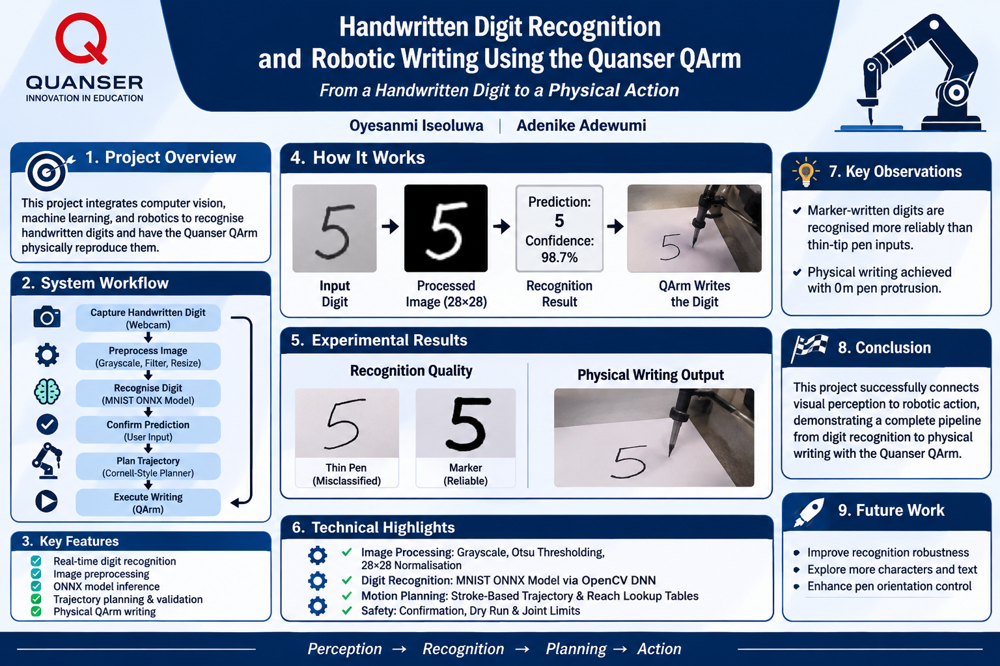

# Handwritten Digit Recognition and Robotic Writing Using the Quanser QArm

**Contributors:** Adenike Adewumi | Oyesanmi Iseoluwa



## Overview

This project combines computer vision, machine learning, and robotic manipulation to enable a Quanser QArm to recognise a handwritten digit and reproduce it on paper.

A webcam captures one handwritten digit. An existing MNIST-trained ONNX model classifies the image, and the predicted digit is passed to a trajectory planner that generates the QArm's writing motion. The project demonstrates an end-to-end perception-to-action pipeline.

## System Workflow

1. **Image capture:** A webcam captures one handwritten digit inside a square region of interest (ROI).
2. **Preprocessing:** The ROI is converted to grayscale, blurred, thresholded, cleaned, tightly cropped, resized while preserving aspect ratio, centred on a black 28 × 28 canvas, and normalised to [0, 1].
3. **Recognition:** OpenCV DNN runs the existing `mnist-8.onnx` model and produces scores for digits 0–9. The scores are converted to a probability distribution using softmax.
4. **Confirmation:** The predicted digit and confidence are displayed. Predictions below 50% are rejected; otherwise, the user must type `YES`.
5. **Trajectory planning:** The digit is represented by a hand-designed glyph. The writer generates Cartesian waypoints and corresponding joint configurations.
6. **Preflight validation:** The complete plan is generated before hardware movement. The writer checks reachability, joint limits, adjacent joint changes, and forward-kinematics position error.
7. **Physical writing:** After a successful dry run, the user must type `WRITE`, provide a calibrated gripper value, and complete the writer's hardware prompts before the QArm moves.

## Project Structure

```text
Qarm_writing_system/
├── README.md
├── assets/
│   └── poster.png
├── docs/
│   └── project_documentation.md
├── mnist-8.onnx
├── mnist_digit_camera.py
├── mnist_qarm_integration.py
├── qarm_writer_main.py
├── qarm_write_text.py
└── paddle_camera_ocr.py
```

| File | Purpose |
|---|---|
| `mnist_digit_camera.py` | Standalone digit recognition from a webcam or saved image. It does not connect to the QArm. |
| `mnist_qarm_integration.py` | Main webcam-to-QArm integration: recognition, confidence check, confirmation, dry run, and writer launch. |
| `qarm_writer_main.py` | Cornell-style QArm writer. It builds reach lookup tables and plans/validates the writing trajectory. |
| `qarm_write_text.py` | Glyph definitions and shared QArm motion, gripper, and fault-monitoring helpers used by the writer. |
| `mnist-8.onnx` | Existing ONNX model used for digit classification. |
| `paddle_camera_ocr.py` | Separate PaddleOCR experiment. It is not part of the main digit-writing pipeline. |
| `docs/project_documentation.md` | Detailed explanation of the system and its implementation. |

## Reproducing the System

The instructions below describe how to reproduce the software workflow from this repository. Physical writing additionally requires a compatible Quanser QArm, its supported Quanser software/drivers, and a correctly configured hardware environment.

### 1. Clone the repository

```bash
git clone https://github.com/adenikeadewumi/Qarm_writing_system.git
cd Qarm_writing_system
```

Keep the repository's directory structure intact. In particular, `mnist-8.onnx`, `mnist_qarm_integration.py`, `qarm_writer_main.py`, and `qarm_write_text.py` are expected to remain together in the repository root.

### 2. Set up Python dependencies

Create and activate a virtual environment:

**Windows (PowerShell)**

```powershell
py -m venv .venv
.\.venv\Scripts\Activate.ps1
python -m pip install --upgrade pip
pip install numpy opencv-python
```

**Linux/macOS**

```bash
python3 -m venv .venv
source .venv/bin/activate
python -m pip install --upgrade pip
pip install numpy opencv-python
```

The camera-recognition scripts use Python, NumPy, and OpenCV. The robotic writer also imports `pal.products.qarm.QArm` and `hal.products.qarm.QArmUtilities`. These are provided through the supported Quanser software/Python environment; they are not installed by the two-package pip command above. Install and configure the Quanser QArm software according to the documentation for the hardware and environment being used.

> **Environment note:** The repository does not currently pin Python or package versions in a dependency lockfile. The commands above install the direct third-party Python packages used by the camera-recognition code; they should not be interpreted as a verified, fully version-pinned environment.

### 3. Run digit recognition on its own

To use the webcam without connecting to the robot:

```bash
python mnist_digit_camera.py --camera 0
```

To classify an image file instead:

```bash
python mnist_digit_camera.py --image path/to/your_digit.png
```

The model file must remain beside the script. In the webcam window, place one dark handwritten digit on a light background inside the ROI and press **SPACE** to recognise it. Press **Q** to quit.

This standalone program is useful for checking the camera, preprocessing, and ONNX inference independently of the QArm.

### 4. Check the QArm writer in dry-run mode

With the Quanser Python environment installed and available, run:

```bash
python qarm_writer_main.py "5" --dry-run
```

Replace `5` with another supported digit. The dry run builds the writing path and checks the planned joint trajectory without sending motion commands to the physical arm.

The writer uses the glyph definitions in `qarm_write_text.py`. It also uses the QArm kinematic utilities to build and verify its reach lookup tables, so the Quanser Python modules are required even for this writer dry run.

Review the printed reachable region, paper-block corners, joint ranges, tool pitch, and forward-kinematics errors. Do not proceed to physical execution unless the planned paper location and trajectory are appropriate for the actual setup.

### 5. Run the integrated webcam-to-QArm workflow

After the standalone recognition and writer dry run have been checked:

```bash
python mnist_qarm_integration.py
```

The integration script uses camera index `0` by default. Its sequence is:

- Press **SPACE** to capture and classify the digit inside the ROI.
- Review the predicted digit and confidence.
- Predictions below 50% do not proceed to the writer.
- Type `YES` to accept a prediction.
- The integration launches `qarm_writer_main.py` in dry-run mode first.
- If the dry run succeeds, review its output and type `WRITE` to request physical writing.
- Enter the calibrated gripper command when prompted.

The integration script resolves the writer and model paths relative to its own file, so it does not depend on the original developer's computer-specific directory.

### 6. Hardware preparation and safety

Physical execution should only be attempted with the supported Quanser hardware/software environment and a clear, supervised work area.

- Confirm the QArm is connected and its drivers/software are functioning.
- Secure the pen and paper in the positions indicated by the writer's printed plan.
- Calibrate the gripper hold value for the actual pen before use. The integration accepts a value from 0.1 to 0.9; do not assume a value that has not been tested.
- Keep hands and objects clear of the robot's movement envelope.
- Review the complete dry-run output before authorising motion.
- Stop if the arm reports a fault, behaves unexpectedly, or the pen/paper setup differs from the plan.

The writer requires a gripper value for hardware execution and includes hardware fault checks, motion timeouts, and a return-to-HOME sequence. These safeguards do not replace direct supervision or the Quanser hardware safety procedures.

## Technical Approach

### Digit recognition

The integration script uses a 280-pixel square camera ROI. It applies grayscale conversion, Gaussian blur, inverted Otsu thresholding, connected-component filtering, tight cropping, aspect-ratio-preserving resize to fit within 20 pixels, centring on a black 28 × 28 canvas, and normalisation to [0, 1]. The resulting tensor has shape `1 × 1 × 28 × 28`.

The ONNX model is loaded with OpenCV DNN. The model was already available; training the classifier is not part of this project.

### Robotic writing

The Cornell-style writer represents each digit as one or more polyline strokes. It generates Cartesian waypoints for pen lowering, drawing, lifting, and travel between strokes. For each pen height, it builds a lookup table from reachable pen-tip radius to shoulder and elbow joint angles. At runtime, the base angle is obtained from `atan2(y, x)`, while the shoulder and elbow values are interpolated from the table.

The current writer settings include a 50 mm letter height, 20 mm letter width, 7 mm letter gap, 30 mm line gap, 5 mm stroke waypoint spacing, 15 mm travel waypoint spacing, and 25 mm approach height. Its configured maximum adjacent joint change is 10 degrees, and its table-versus-forward-kinematics verification tolerance is 0.5 mm.

## Experimental Observations

The integrated system was used to recognise and physically reproduce several different handwritten digits with the Quanser QArm. Marker-written digits were generally recognised more reliably than thin-tip pen inputs, indicating that stroke thickness and image quality affect the classifier's input.

Physical writing experiments were conducted with a pen protrusion setting of 0 m. The writer's current source default is also `PEN_PROTRUSION = 0`; measure the pen/tool geometry and adjust this setting only when recalibrating the physical setup.

No aggregate recognition-accuracy figure is claimed in this repository.

## Scope and Limitations

- The integrated workflow is designed for one handwritten digit at a time, from 0 to 9. It is not general handwriting recognition or arbitrary text OCR.
- The ONNX classifier is used for inference; it was not trained by the project contributors as part of this work.
- The separate `paddle_camera_ocr.py` experiment is not integrated into the main workflow.
- `qarm_write_text.py` contains glyphs for letters and digits, but the integrated MNIST workflow passes a single recognised digit to the Cornell-style writer.
- Reproducing physical writing requires the Quanser QArm and its supported software/drivers. A standard computer with a webcam can reproduce the recognition-only stage.

## Contributors

- **Adenike Adewumi**
- **Oyesanmi Iseoluwa**
